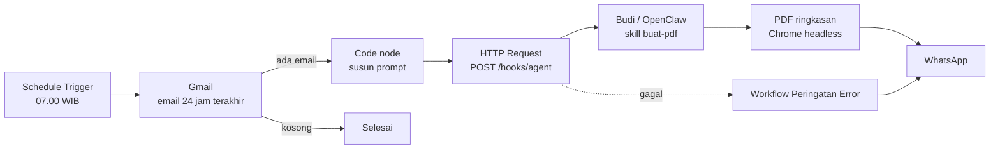
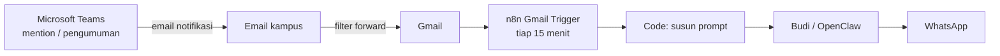

# Budi Email Digest

Otomasi harian yang memeriksa email baru setiap pukul 07.00 WIB, merangkumnya menjadi PDF dengan AI agent, lalu mengirimkannya ke WhatsApp. Kalau tidak ada email baru, workflow berhenti dan tidak mengirim apa pun.

## Arsitektur



Semua komponen berjalan di satu VPS Ubuntu. n8n dan gateway OpenClaw hanya mendengarkan di `127.0.0.1`, jadi tidak ada port yang terbuka ke internet. Untuk mengakses dashboard dari laptop, pakai SSH tunnel.

## Teknologi

| Komponen | Peran |
|---|---|
| **n8n** (Docker) | Penjadwal dan orkestrasi workflow |
| **Gmail API** (OAuth2) | Mengambil email baru |
| **OpenClaw** | AI agent "Budi": merangkum, membuat PDF, mengirim ke WhatsApp |
| **Chrome headless** | Mengubah HTML menjadi PDF |
| **WhatsApp** | Saluran pengiriman laporan dan peringatan error |

## Isi repo

```
workflows/
  email-pagi.json          # workflow utama (export n8n)
  peringatan-error.json    # dikirim ke WhatsApp jika workflow utama gagal
openclaw/
  skills/buat-pdf/SKILL.md # instruksi agent untuk membuat dan mengirim PDF
  hooks.example.json       # konfigurasi webhook OpenClaw
  .env.example             # contoh variabel rahasia
docker/
  docker-compose.yml       # konfigurasi container n8n
```

## Keamanan

- **Prompt injection**: isi email diapit tag `<email>` dan ditandai sebagai data, bukan instruksi. Agent diminta tidak menjalankan perintah, membuka tautan, atau mengikuti permintaan apa pun dari isi email.
- **Rahasia**: token hook disimpan di `.env` (izin file `600`) dan di credential n8n. Tidak ada token di workflow maupun di repo ini.
- **Jaringan**: n8n dan OpenClaw hanya bisa diakses dari `127.0.0.1`. Firewall `ufw` hanya membuka port SSH, 80, dan 443.
- **Idempotency**: setiap permintaan ke hook membawa `Idempotency-Key` per tanggal, jadi laporan yang sama tidak terkirim dua kali.
- **Docker**: user aplikasi tidak dimasukkan ke grup `docker`, karena anggota grup itu setara dengan root.

## Cara memasang

1. Jalankan n8n:
```bash
   cd docker && sudo docker compose up -d
```
2. Aktifkan hooks OpenClaw. Salin `openclaw/.env.example` ke `~/.openclaw/.env`, isi tokennya dengan hasil `openssl rand -hex 32`, terapkan konfigurasi dari `hooks.example.json`, lalu restart gateway.
3. Salin `openclaw/skills/buat-pdf/` ke folder `skills/` di workspace OpenClaw.
4. Di n8n, import kedua file di `workflows/`, lalu buat dua credential:
   - **Gmail OAuth2**
   - **Header Auth**: `Authorization: Bearer <token>`
5. Ganti `+62XXXXXXXXXX` dengan nomor WhatsApp tujuan.
6. Di pengaturan workflow utama, jadikan "Peringatan Error" sebagai Error Workflow, lalu aktifkan workflow.

## Yang saya pelajari

- Menghubungkan n8n dengan AI agent melalui webhook yang diautentikasi dengan token
- Menangani OAuth2 Google dalam mode Testing (token kedaluwarsa setiap 7 hari)
- Merancang prompt yang tahan terhadap prompt injection dari data eksternal
- Menjalankan layanan di VPS secara aman: hanya mendengarkan di loopback, akses lewat SSH tunnel, rahasia di `.env`
- Mengirim peringatan otomatis saat workflow gagal

## Keterbatasan

- Aplikasi OAuth Google masih dalam mode Testing, jadi akun Gmail perlu login ulang setiap 7 hari.
- Model AI yang murah kadang gagal menjalankan tugas multi-langkah (membuat dan mengirim PDF). Model yang lebih kuat lebih andal.

## Workflow tambahan: Mention Teams

`workflows/mention-teams.json` memantau email notifikasi Microsoft Teams (mention, pengumuman) setiap 15 menit, lalu Budi mengirim ringkasan singkat ke WhatsApp. Pengumuman perubahan jadwal atau tugas ditandai ⚠️.



**Keterbatasan:** notifikasi tugas baru (Assignments) tidak dikirim lewat email oleh Teams, jadi belum tertangkap. Percobaan dengan Power Automate (trigger *new channel message*, kirim email) berhasil menangkap postingan, tetapi email ditolak Gmail sebagai spam karena kebijakan domain kampus. Ini masih dalam eksplorasi.
